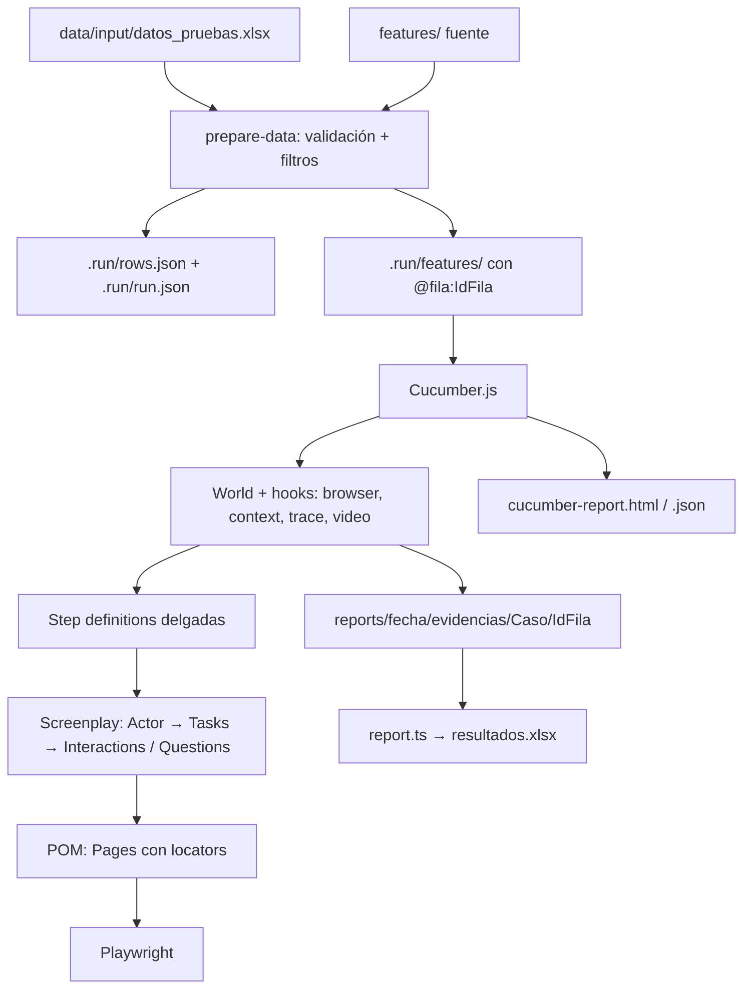

# Arquitectura

## Capas
| Capa | Ubicación | Responsabilidad |
|---|---|---|
| Gherkin | `features/` | QUÉ, en lenguaje de negocio |
| Steps | `src/steps/` | Traducir frase → Screenplay; aserciones |
| Screenplay | `src/screenplay/` | CÓMO en términos de negocio (Actor, Tasks, Interactions, Questions) |
| POM | `src/pages/` | DÓNDE: solo locators |
| Infraestructura | `src/support/` | World, hooks, evidencias |
| Datos | `src/controller/`, `scripts/` | Excel → features por fila |
| Registro | `src/registry/casos.ts` | TestCaseId ↔ feature ↔ hoja |

## Decisiones
- **Browser perezoso:** se lanza en el primer `Before` (y no en `BeforeAll`) porque el perfil `headed` llega por `worldParameters`.
- **Sin esperas fijas:** auto-wait, `waitFor`, `waitForURL` y aserciones web-first. Los timeouts están en `src/config/config.ts`.
- **`retry: 0`:** no se reintentan acciones que cambian datos.
- **Textos generados:** las longitudes exactas se generan por código (no pegados a mano).
- **Nombre del script `prepare-data`:** `prepare` es un ciclo de vida de npm y se ejecutaría en cada `npm install`.
- **Agregar un caso (OCP):** feature + hoja Excel + steps/Tasks + una línea en el registro.
